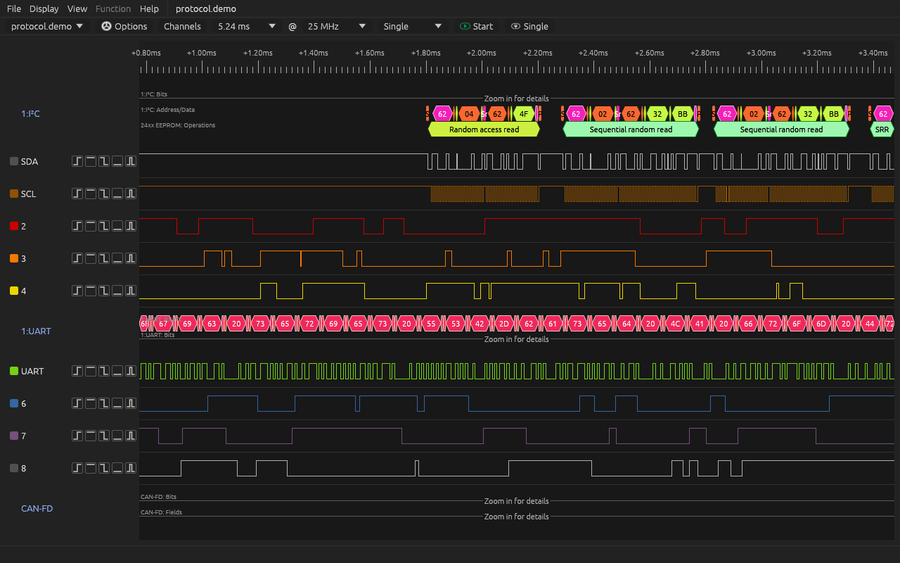
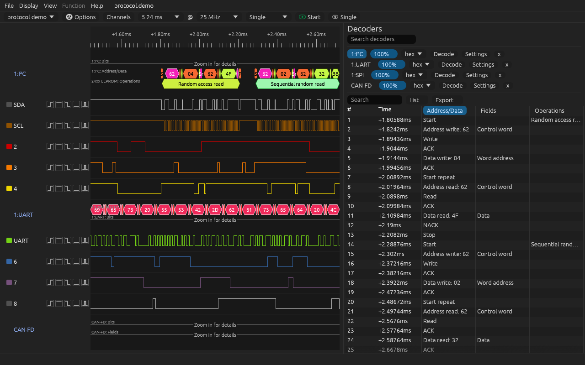
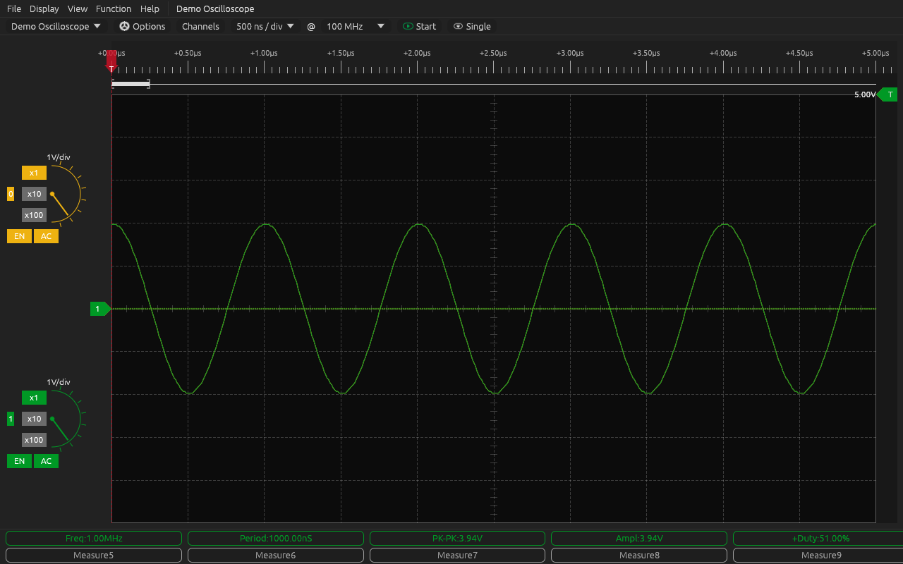

# DSViewR

DSViewR is logic analyzer and oscilloscope software for
[DreamSourceLab](https://www.dreamsourcelab.com) instruments (DSLogic, DSCope, and the Hermelin
MSO-E8). It is a rewrite of [DSView](https://github.com/DreamSourceLab/DSView) in Rust. The GUI,
drivers, file formats, sample stores and decoder engine are all Rust; the more than 150 protocol
decoders are the sigrok Python decoders DSView ships.



| Protocol table | Oscilloscope |
|---|---|
|  |  |

## Features

- **Logic analyzer:** buffer and stream capture at every rate of the DSLogic channel modes;
  simple, advanced (multi-stage) and serial triggers, set per channel with the trigger buttons
  next to the channel name; cursors, measurements and edge search. A capture that would not fit
  into the free memory is refused with a message instead of running out of memory.
- **Protocol decoders:** 150+ decoders (I²C, SPI, UART, CAN/CAN-FD, I3C, SMBus/PMBus, JTAG,
  SENT, DShot, …), stacked decoders, decoding while a stream capture runs, and a time-aligned
  protocol table with search and CSV/TXT export.
- **Oscilloscope and data acquisition:** V/div and timebase controls, trigger settings,
  measurements, math channels, FFT, Lissajous view, persistence, reference waveforms,
  histograms, channel-to-channel measurements, and a demo oscilloscope for use without hardware.
- **Files:** opens and saves DSView's `.dsl` captures and `.dsc` profiles; exports CSV, VCD and
  srzip (readable by sigrok-cli and PulseView).
- **`dsviewr-cli`:** captures, exports and decodes from the command line, and runs DSViewR
  headless behind its control socket (`serve --mcp`).
- **Automation:** a JSON-RPC control socket (`DSViewR --mcp`) and an MCP server
  ([`dsview-mcp`](dsview-mcp/README.md)), so scripts and AI agents can drive captures and read
  the results.
- **Interface:** dark, light, Catppuccin Latte and Frappé themes; English, German and Chinese
  (with a built-in CJK font, so Chinese works without system fonts); keyboard shortcuts;
  accessible to screen readers (AT-SPI).

## Install

Linux, x86-64. Packages are on the [releases page](https://github.com/phil16021/DSView_rust/releases):

- **Debian/Ubuntu (`dsviewr_*.deb`):** `sudo apt install ./dsviewr_*.deb`. It replaces an
  installed `dsview` package, carries its own Python, and installs the udev rule that gives
  users access to the instruments.
- **AppImage (`DSViewR-x86_64.AppImage`):** `chmod +x` it and run it. For USB access the udev
  rule has to be installed once; DSViewR shows the command for it on its first start.

Tested on Ubuntu 22.04, 24.04 and 26.04.

## First steps

Start `DSViewR`. Without an instrument, choose *Demo Logic* or *Demo Oscilloscope* in the
device list and press **Start**. *File → Open* opens `.dsl` captures, for example the demo in
`/usr/share/dsview/demo/logic/protocol.demo`, which comes with I²C, UART, SPI and CAN-FD decoders.

## dsviewr-cli

```sh
dsviewr-cli devices                                   # instruments and demo devices
dsviewr-cli capture --device dslogic --samplerate 10000000 --samples 1000000 --out cap.dsl
dsviewr-cli export cap.dsl cap.csv                    # .csv, .vcd or .srzip
dsviewr-cli decode cap.dsl --decoder i2c:scl=0,sda=1  # one line per annotation
dsviewr-cli verify-counter --device dslogic           # DSLogic internal test mode
dsviewr-cli selftest --out report/                    # a report bundle for bug reports
dsviewr-cli diff-dsl a.dsl b.dsl                      # first differing sample per channel
dsviewr-cli decode a.dsl --decoder uart:rxtx=0 --json > a.json
dsviewr-cli diff-ann a.json b.json                    # first differing annotation
dsviewr-cli serve --mcp                               # headless, behind the control socket
```

`dsviewr-cli --help` lists every option.

## When something goes wrong

- **Log:** *Help → Log Options* sets the level and writes `~/DSViewR.log`; `dsviewr-cli` takes
  `--log-level 0-5`.
- **Crash reports:** a crash writes the message, a backtrace and the last 200 log lines to
  `~/.local/state/dsview/crash/` (or `$XDG_STATE_HOME/dsview/crash/`). Nothing is uploaded.
- **A decoder hangs or crashes:** start with `DSVIEW_PY_FAULTHANDLER=10` to print the Python
  stack of every thread every 10 seconds (`=1`: only on a crash).
- **Bug reports:** `dsviewr-cli selftest --out DIR` collects the device settings, a capture and
  the full log; please attach the directory to the issue.

## Building from source

Requirements: Rust (the version in `rust-toolchain.toml`, installed by rustup) and the Python
development files (`python3-dev`).

```sh
cargo build --release -p dsview-gui -p dsview-cli
target/release/dsview        # DSViewR; finds its data in assets/
target/release/dsview-cli    # dsviewr-cli
```

The packages are built by `.github/workflows/build.yml` with `cargo deb` and the scripts in
`tools/package/`. Tests: `cargo nextest run --workspace` and `cargo xtask golden check`; CI also
runs the control-API transcript, the MCP suite, fuzzing, Miri on the sample stores and an ingest
benchmark (`.github/workflows/rust.yml`). Windows and macOS are not supported yet; the workspace
type-checks for Windows in CI as groundwork for a port.

## Project status

DSViewR 1.0 has the features of the Qt DSView it replaces, as listed in
[docs/migration/PARITY.md](docs/migration/PARITY.md) (gnuplot export is gone; srzip is new). It was ported subsystem by subsystem and
compared with the original C/C++ code at each step: file formats, sample stores and decoder
output byte for byte, and USB traffic on a DSLogic Plus. The tag `c-final` holds the last tree
with that C code and the comparison tools.

Since 1.0, the post-parity work (M7b) fixed the defects found while porting and retired Qt
quirks: data loss in captures whose length is not a multiple of 64, decoder hangs and crashes
found by a decoder soak test, the DSO envelope, a faster capture ingest (above 1 GB/s) with a
queue between USB and the sample store, and several start/stop races.

- How the port was done, and what is left: [docs/migration/PLAN.md](docs/migration/PLAN.md),
  [docs/migration/M7b-PLAN.md](docs/migration/M7b-PLAN.md),
  [docs/migration/STATUS.md](docs/migration/STATUS.md).
- Where DSViewR intentionally behaves differently, and the defects of the original that were
  found: [docs/migration/DEVIATIONS.md](docs/migration/DEVIATIONS.md).
- **DSCope and MSO-E8 owners:** the drivers are checked against the C drivers on a simulated
  device but not yet on real hardware. Please run `dsviewr-cli selftest --out DIR` and attach
  the directory to an issue, whether it works or not.

Bugs and requests: [issues](https://github.com/phil16021/DSView_rust/issues).

## Credits

- [DreamSourceLab](https://www.dreamsourcelab.com), for DSView and the instruments.
- The [sigrok project](https://sigrok.org), on which DSView is based, and the authors of the
  protocol decoders.
- [Schildkroet's DSView fork](https://github.com/Schildkroet/DSView), the starting point of this
  rewrite.

## License

GNU General Public License, version 3 or later ([COPYING](COPYING)). The protocol decoders,
firmware and FPGA bitstreams in `assets/` keep the licenses stated in their files (see
`assets/res/license.txt`).
